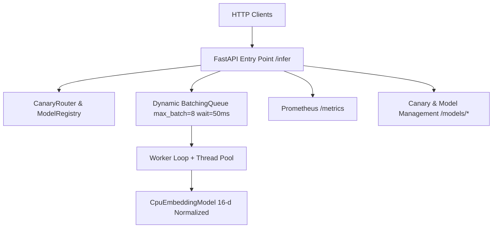

# Inference Server

A high-performance CPU-first ML serving layer with dynamic batching, bounded queuing, model versioning, canary routing, Prometheus observability, and VectorDB + RAG integration.

## Quick Start

```sh
# Setup environment and install dependencies
python -m venv .tmp-python
.tmp-python/Scripts/pip install -e '.[dev]'

# Run full test suite, linters, type checks
.tmp-python/Scripts/python -m pytest
.tmp-python/Scripts/python -m ruff check src tests scripts
.tmp-python/Scripts/python -m mypy src

# Run server
.tmp-python/Scripts/python -m uvicorn inference_server.api:app --reload
```

Server will be active at `http://127.0.0.1:8000`.

## Architecture Overview



## Features & Milestones

- **I0 — Foundation**: FastAPI application, `/health` endpoint, pytest, Ruff linting, mypy typing, GitHub Actions CI.
- **I1 — Baseline Inference**: Deterministic 16-dimensional L2-normalized CPU embedding model (`CpuEmbeddingModel`) and repeatable in-process benchmark.
- **I2 — Bounded Queue & Inference API**: Bounded semaphore request admission, client wait timeouts, HTTP 429 overload shedding, HTTP 503 timeout mapping.
- **I3 — Dynamic Batching**: Configurable `BatchingQueue` (`max_batch_size=8`, `max_wait_seconds=0.05`) with deterministic bounded shutdown draining.
- **I4 — Performance Evaluation**: HTTP load testing script (`scripts/benchmark_http.py`) measuring throughput and p50, p95, p99 latencies.
- **I5 — Reliability & Backpressure**: Concurrency backpressure, error isolation, response determinism under load.
- **I6 — Model Registry**: Thread-safe `ModelRegistry` and immutable `ModelHandle` for atomic version hot-swapping.
- **I7 — Canary Deployment**: `CanaryRouter` supporting traffic splitting, live promotion, and instant rollback via `/models/canary`, `/models/promote`, `/models/rollback`.
- **I8 — Quantization Evaluation**: INT8 uniform quantization simulation (`SimulatedQuantizedModel`) measuring cosine similarity precision preservation (>0.99 agreement).
- **I9 — Monitoring & Observability**: Prometheus text-format exporter at `/metrics` tracking request counters by HTTP status and model version, latency sums, overflows, and timeouts.
- **I10 — RAG Integration & Release**: `RemoteInferenceClient` and `InProcessEmbeddingAdapter` fulfilling VectorDB + RAG `EmbeddingProvider` protocol, Docker support (`Dockerfile`), and release checks.

## API Examples

### Health Check
```sh
curl http://127.0.0.1:8000/health
# {"status": "ok"}
```

### Run Inference
```sh
curl -X POST http://127.0.0.1:8000/infer \
  -H "Content-Type: application/json" \
  -d '{"text": "Search query text", "timeout_seconds": 2.0}'

# Response:
# {
#   "embedding": [0.0912, 0.1824, ...],
#   "model_version": "cpu-embedding-v1"
# }
```

### Prometheus Metrics
```sh
curl http://127.0.0.1:8000/metrics
```

### Canary Deployment Management
```sh
# 1. View active model status
curl http://127.0.0.1:8000/models/active

# 2. Deploy v2 as 20% canary
curl -X POST http://127.0.0.1:8000/models/canary \
  -H "Content-Type: application/json" \
  -d '{"version": "cpu-embedding-v2", "weight": 0.2}'

# 3. Rollback immediately
curl -X POST http://127.0.0.1:8000/models/rollback

# 4. Promote canary to 100% primary
curl -X POST http://127.0.0.1:8000/models/promote
```

## Benchmarks & Performance Results

Run the HTTP load test:
```sh
.tmp-python/Scripts/python scripts/benchmark_http.py
```

| Strategy | Throughput (req/s) | p50 Latency | p95 Latency | p99 Latency | Error Rate |
|---|---|---|---|---|---|
| **Dynamic Batching (I3)** | **1,127.02 req/s** | **22.07 ms** | 31.73 ms | 33.84 ms | 0.0% |
| Single Queue (I2) | 1,094.30 req/s | 26.72 ms | 29.19 ms | 29.81 ms | 0.0% |

## Docker Support

```sh
docker build -t inference-server:latest .
docker run -p 8000:8000 inference-server:latest
```

## Limitations

- Local CPU model produces deterministic 16-dimensional test vectors for serving layer validation.
- Zero external native ML binary dependencies (e.g. PyTorch/ONNX Runtime) required by default to keep local development light and free.
